# OOGAM 디자인 검수 자료

> 대표 검토용 · 캡처 2026-11-07 · 화면 18종 / 스크린샷 46장

## 확인 방법

| 방법 | 위치 |
|---|---|
| **HTML 갤러리 (권장)** | `docs/design-review/index.html` — 저장소를 내려받은 뒤 브라우저로 열기. 필터·확대 보기 지원 |
| 이 문서 | `docs/OOGAM_DESIGN_REVIEW.md` — GitHub에서 이미지와 함께 표시 |
| 원본 스크린샷 | `docs/design-review/screens/*.png` (데스크톱 1440px, 모바일 390px·2배 해상도) |

**캡처 조건**
- 현재 프로덕션 빌드를 실제 브라우저(Chromium)로 열어 캡처했습니다. 개발 서버 표시나 임시 화면이 아닙니다.
- 실제 서체 Pretendard로 렌더링했습니다. 이전 `docs/screenshots/` 자료(61장)는 개발 서버·대체 서체 상태였으므로 이번 자료로 대체해 보시기 바랍니다.
- **모든 데이터는 가상입니다.** 이름에 "샘플"·"데모"·"가상"이 붙은 브랜드·프로젝트·직원·거래는 검수용으로 만든 것이며 실제 고객·직원 정보는 사용하지 않았습니다. 실제 브랜드 후보는 법인 관계 확인 전이라 공개 화면에 넣지 않았습니다.
- 공개 사이트 문구 중 "CMS에서 작성하세요"는 실제 현재 상태입니다 (아직 문구 미입력).

**상태 표기**: 구현 완료 / 부분 구현(일부 기능 후속) / 기능 완료 · 콘텐츠 필요(화면은 동작하나 실제 문구·이미지 입력 필요)

## 1. 대표 결정이 필요한 항목 (우선순위 순)

| # | 항목 | 내용 | 우선순위 |
|---|---|---|---|
| 1 | **공개 사이트 문구 확정** | 회사 소개·사업 영역·채용 안내·메인 소개 문단에 "CMS에서 작성하세요" 안내문이 공개 화면에 보입니다. 운영 전 실제 문구가 필요합니다. 담당자가 관리자 CMS에서 바로 입력할 수 있습니다. | 높음 |
| 2 | **브랜드 공개 범위와 자료** | 듣다·Louver·247Streams·콘텐츠 제작·교육의 법인 관계를 확인한 뒤 공개 여부를 정해 주세요. 공개할 브랜드는 로고·대표 이미지·소개 문구가 필요합니다. | 높음 |
| 3 | **비주얼 방향: 사진 중심 vs 타이포 중심** | 현재는 이미지 없이 타이포그래피만으로 구성되어 포트폴리오·사업 영역이 비어 보입니다. 프로젝트 사진·영상 썸네일을 준비할지, 이미지 없는 타이포 중심 디자인으로 다듬을지 정해 주세요. | 높음 |
| 4 | **푸터 회사 정보** | 상호·대표자·사업자등록번호·주소·대표 연락처 표기 여부와 내용을 정해 주세요. 현재 푸터에는 메뉴와 문의 링크만 있습니다. | 중간 |
| 5 | **메뉴·섹션 언어 정책** | 공개 메뉴와 섹션 제목을 영문으로 유지할지, 국문 병기할지 정해 주세요. 현재 영문과 국문이 섞여 있습니다. | 중간 |
| 6 | **관리자 상태 색상** | 업무 상태 배지에 색(파랑·노랑·초록)을 쓸지, 흑백 톤 + 아이콘으로 통일할지 정해 주세요. 색은 상태 파악이 빠르고, 흑백은 브랜드 일관성이 높습니다. | 중간 |
| 7 | **관리자 메뉴 그룹화** | 14개 메뉴를 업무(내 업무·프로젝트·문서·데이터베이스·캘린더) / 경영(전자결재·재무) / 조직(직원·부서·공지·파일) / 관리(CMS·설정)로 묶을지 정해 주세요. | 낮음 |
| 8 | **Hero 대형 "OOGAM" 워드마크** | 메인 첫 화면에 헤드라인과 대형 워드마크가 함께 있습니다. 강한 브랜드 인상을 유지할지, 헤드라인만 남겨 간결하게 할지 정해 주세요. | 낮음 |

**결정 없이 다음 개발에서 바로 고칠 항목**

- 한글 라벨의 과도한 자간 제거
- 업무·직원 상세 패널의 배경 처리 통일
- 날짜 입력을 한국식(YYYY. MM. DD.) 표시로 통일
- 모바일 에디터 툴바를 한 줄 스크롤 또는 "더보기"로 정리, 툴바 버튼에 이름 표시(툴팁)
- 전자결재 상세를 열 때 해당 문서가 있는 탭으로 자동 전환
- 파트너십 CTA 모서리를 다른 요소와 같은 직각으로 통일
- 대시보드 지표 카드 수를 그리드에 맞게 조정 (모바일 2열 짝수)
- 칸반 열마다 업무 추가 버튼, 키보드 이동 지원

## 2. 디자인 시스템 검토

| 항목 | 판정 | 평가 |
|---|---|---|
| 타이포그래피 | 양호 | Pretendard 단일 서체로 국문·영문이 일관됩니다. 공개 사이트는 초대형 디스플레이(Hero 최대 156px)와 작은 영문 라벨의 대비가 강해 프리미엄 미디어 회사다운 인상을 줍니다. 관리자는 13~15px 본문으로 정보 밀도가 적절합니다. |
| 여백 · 그리드 | 보완 필요 | 12열 그리드와 넉넉한 섹션 여백이 일관됩니다. 관리자 화면은 카드·표 간격이 고르고 정렬이 정확합니다. |
| 색상 | 결정 필요 | 공개 사이트는 블랙 #0A0A0A · 화이트 · 회색만 사용하고 포인트 컬러(오렌지)는 긴급 표시 등에 최소 사용해 방향과 일치합니다. 재무 차트도 흑백 톤입니다. |
| 메뉴 구성 | 결정 필요 | 공개 사이트는 영문 7개 메뉴(About · Business · Brands · Portfolio · News · Careers · Contact)로 간결합니다. 관리자는 14개 메뉴가 한 줄 목록이며 권한에 따라 자동으로 숨겨집니다. |
| 정보 위계 | 양호 | 대시보드 → 목록 → 상세 패널 흐름이 일관되고, 핵심 수치를 먼저 보여줍니다. 재무 대시보드는 지표 → 추이 → 구분별 → 미승인 순서가 명확합니다. |
| 반응형 | 양호 | 데스크톱·태블릿·모바일에서 가로 스크롤 없이 동작하며, 관리자 사이드바는 모바일 드로어로 전환됩니다. 키보드 포커스·명도 대비 자동 점검(axe) 심각 문제는 0건입니다. |

**타이포그래피 — 보완점**
- 한글 라벨에도 넓은 자간이 적용되어 "크 리 에 이 티 브"처럼 글자가 흩어져 보임 (브랜드 카드·채용 메타)
- 섹션 제목이 영문(Selected Work, Latest)과 국문(OOGAM과 함께하는 브랜드)으로 섞여 있음 — 언어 정책 결정 필요

**여백 · 그리드 — 보완점**
- 콘텐츠가 없는 영역(사업 영역 카드 상단, 회사 소개)이 큰 빈 공간으로 남음
- 모바일 홈이 약 7,500px로 김
- 파트너십 CTA만 둥근 모서리이고 나머지는 직각이라 형태 언어가 섞임

**색상 — 보완점**
- 관리자 상태 배지(진행 중=파랑, 검토=노랑, 완료=초록)와 개발 상태 안내(노랑)가 흑백 기조에서 벗어남 — 기능적 색으로 유지할지 결정 필요
- 음수 금액은 빨강 표시 (유지 권장)

**메뉴 구성 — 보완점**
- 관리자 메뉴 14개가 묶음 없이 나열 — "업무 / 경영 / 조직 / 관리" 그룹화 제안
- 공개 메뉴 언어(영문 유지 vs 국문 병기) 결정 필요

**정보 위계 — 보완점**
- 전자결재 상세와 왼쪽 목록 탭이 어긋날 수 있음
- 업무 패널(어둡게)과 직원 패널(흐리게)의 배경 처리가 다름
- 편집기 툴바가 아이콘만 있어 기능 파악이 어려움

**반응형 — 보완점**
- 모바일 에디터 툴바 3줄
- 데이터베이스 보드는 넓은 화면에서도 가로 스크롤
- 대시보드 지표 카드 5개가 모바일에서 마지막 1개만 남음

## 3. 화면별 검토

| 상태 | 화면 수 |
|---|---|
| 구현 완료 | 8 |
| 부분 구현 | 5 |
| 기능 완료 · 콘텐츠 필요 | 5 |

### 공식 홈페이지

#### 메인 — 기능 완료 · 콘텐츠 필요

경로: `/`

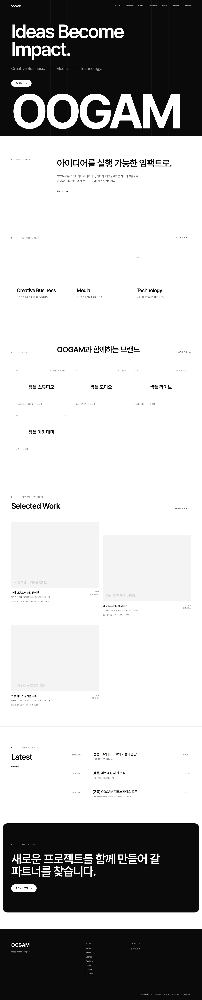

추가 화면: [home-mobile](design-review/screens/public-home-mobile.png) · [menu-open-mobile](design-review/screens/public-menu-open-mobile.png)

**구현 완료**
- 9개 섹션 구성: 내비게이션, Hero, 회사 소개, 사업 영역, 브랜드, 프로젝트, 뉴스, 파트너십 CTA, 푸터
- Hero 문구는 CMS에서 수정 가능 (현재 "Ideas Become Impact." 임시 카피)
- 게시 승인된 콘텐츠만 노출, 게시 취소 즉시 반영
- 모바일 전체 화면 메뉴, 스크롤 시 헤더 전환

**미완성 · 개선 필요**
- 회사 소개 문단에 "(임시 소개 문구 — CMS에서 수정하세요)"가 공개 화면에 그대로 보임
- 프로젝트 카드 이미지가 없어 회색 박스로 표시
- 사업 영역 카드에 이미지·아이콘이 없어 카드 상단이 비어 보임
- 모바일에서 홈 전체 길이가 약 7,500px로 김 (사업 영역 카드의 빈 높이가 원인)

#### 회사 소개 — 기능 완료 · 콘텐츠 필요

경로: `/about`

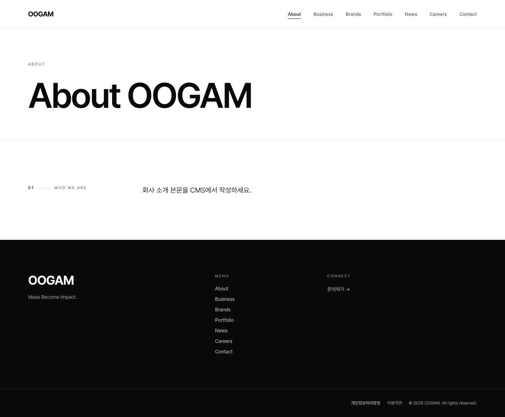

**구현 완료**
- CMS 고정 페이지(제목·본문·SEO) 편집·게시 연동

**미완성 · 개선 필요**
- 본문이 "회사 소개 본문을 CMS에서 작성하세요." 안내문으로 공개됨
- 연혁·비전·조직·대표 인사말 같은 회사 소개 전용 섹션 구조가 없음 (제목+본문 1단 구조)
- 내용이 짧아 푸터가 화면 중간에서 시작

#### 사업 영역 — 기능 완료 · 콘텐츠 필요

경로: `/business`

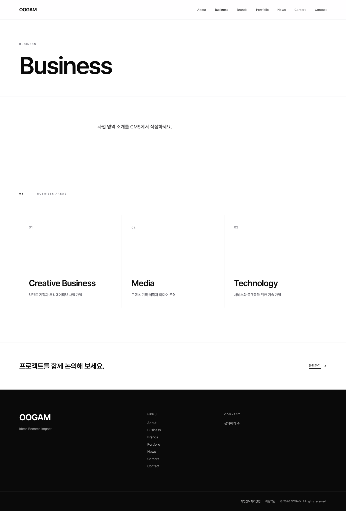

**구현 완료**
- 3개 사업 영역(Creative Business · Media · Technology) 카드
- 하단 문의 유도 문구

**미완성 · 개선 필요**
- 소개 문단이 "사업 영역 소개를 CMS에서 작성하세요."로 공개됨
- 영역별 상세 설명·사례 연결·이미지 없음

#### 브랜드 — 기능 완료 · 콘텐츠 필요

경로: `/brands · /brands/[slug]`

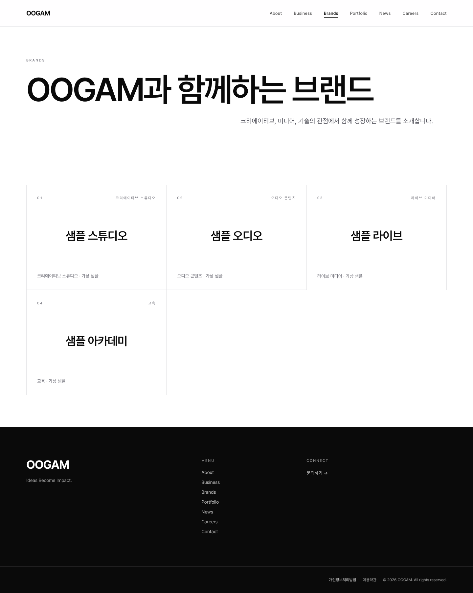

추가 화면: [brand-detail-desktop](design-review/screens/public-brand-detail-desktop.png) · [brands-mobile](design-review/screens/public-brands-mobile.png)

**구현 완료**
- 브랜드 목록·상세, CMS에서 이름·로고·소개·이미지·웹사이트·노출 순서 관리
- 법인 관계 메모가 있는 브랜드는 게시 전 확인 절차 (관리자 경고)

**미완성 · 개선 필요**
- 실제 브랜드(듣다, Louver, 247Streams, 콘텐츠 제작·교육)는 법인 관계 확인 전이라 비공개 상태 — 화면은 가상 샘플
- 로고·이미지가 없으면 텍스트만 표시되어 카드가 단조로움
- 4개일 때 3열 그리드에 빈 칸 2개가 남음

#### 포트폴리오 — 부분 구현

경로: `/portfolio`

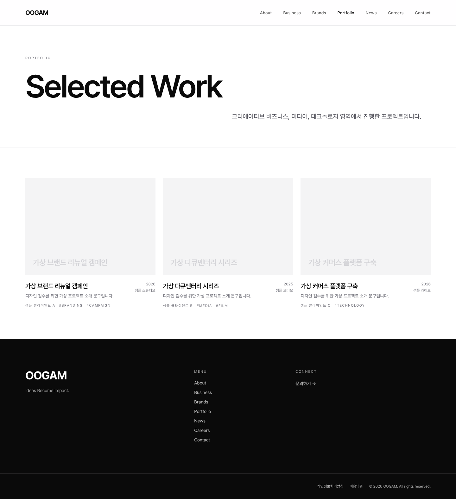

**구현 완료**
- 게시된 프로젝트 목록, 대표 프로젝트(featured)는 메인에 노출, 태그·연도·클라이언트 표기

**미완성 · 개선 필요**
- 포트폴리오 개별 상세 페이지 없음 (목록만)
- 이미지 미등록 시 회색 자리표시

#### 뉴스 · 채용 — 기능 완료 · 콘텐츠 필요

경로: `/news · /careers`

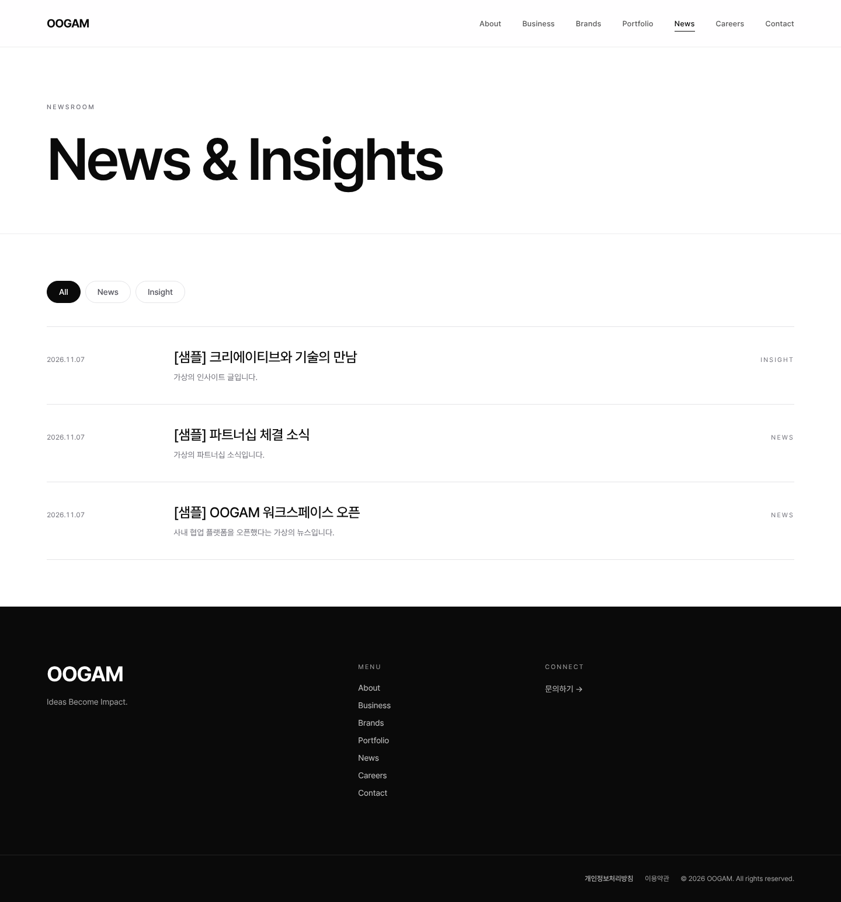

추가 화면: [careers-desktop](design-review/screens/public-careers-desktop.png)

**구현 완료**
- 뉴스/인사이트 탭, 상세 페이지, 안전한 마크다운 렌더링
- 채용 공고(근무지·고용형태·마감일)와 상세 페이지

**미완성 · 개선 필요**
- 채용 페이지 상단 안내가 "채용 안내 문구를 CMS에서 작성하세요."로 공개됨
- 외부 지원 링크/지원서 접수 기능 없음

#### 문의 — 구현 완료

경로: `/contact`

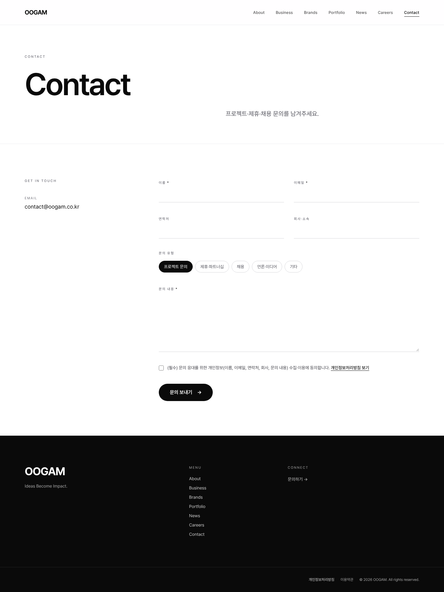

추가 화면: [contact-mobile](design-review/screens/public-contact-mobile.png)

**구현 완료**
- 이름·이메일·연락처·회사·유형·내용 입력과 검증
- 개인정보 수집 동의 필수, 스팸 차단(숨김 필드·요청 제한)
- 접수 시 관리자 알림, CMS 문의 관리 화면

**미완성 · 개선 필요**
- 접수 확인 자동 회신 메일 없음 (SMTP 설정 후 가능)
- 주소·지도·대표 전화 표기 없음

### 관리자 워크스페이스

#### 로그인 · 2단계 인증 — 구현 완료

경로: `/admin/login · /admin/mfa`

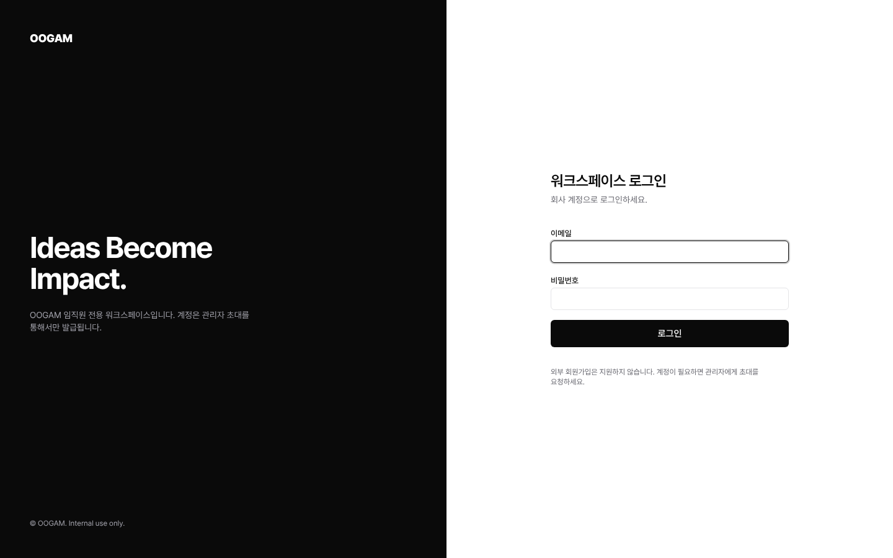

추가 화면: [login-mobile](design-review/screens/admin-login-mobile.png)

**구현 완료**
- 초대 기반 계정(외부 가입 없음), 로그인 시도 제한
- 인증 앱(TOTP) 2단계 인증, 복구 코드, 경영진 필수 정책

**미완성 · 개선 필요**
- 패스키(WebAuthn)·신뢰 기기 기억 미지원

#### 대시보드 — 구현 완료

경로: `/admin`

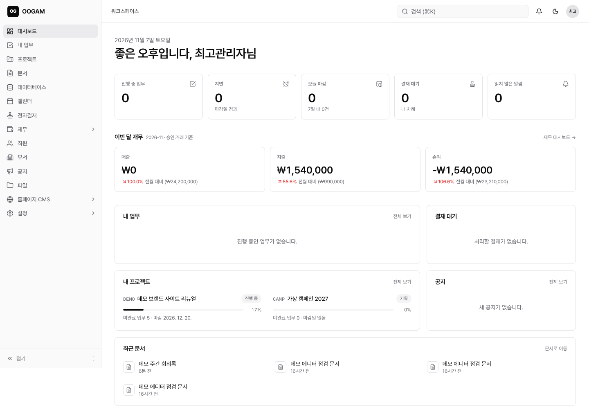

추가 화면: [dashboard-mobile](design-review/screens/admin-dashboard-mobile.png) · [dashboard-dark-desktop](design-review/screens/admin-dashboard-dark-desktop.png) · [sidebar-collapsed-desktop](design-review/screens/admin-sidebar-collapsed-desktop.png) · [drawer-open-mobile](design-review/screens/admin-drawer-open-mobile.png)

**구현 완료**
- 업무 지표(진행·지연·오늘 마감·결재 대기·알림)
- 이번 달 재무 요약 (재무 권한자에게만 표시)
- 내 업무·결재 대기·내 프로젝트·공지·최근 문서
- 다크 모드, 사이드바 접기, 모바일 드로어 메뉴, 키보드 단축키(⌘K 검색)

**미완성 · 개선 필요**
- 지표 카드 5개가 모바일 2열 배치에서 마지막 카드 1개만 한 줄에 남음
- 역할별(대표/팀장/직원) 맞춤 대시보드 구성 없음

#### 프로젝트 — 부분 구현

경로: `/admin/projects · /admin/projects/[id]`

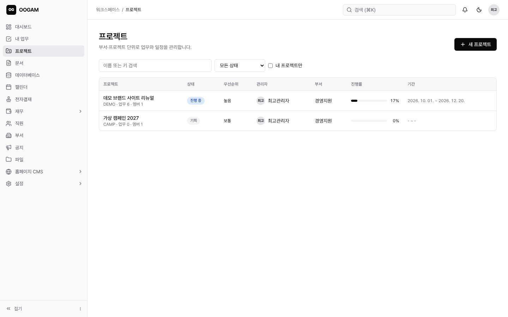

추가 화면: [project-list-desktop](design-review/screens/admin-project-list-desktop.png) · [timeline-desktop](design-review/screens/admin-timeline-desktop.png) · [my-tasks-desktop](design-review/screens/admin-my-tasks-desktop.png)

**구현 완료**
- 프로젝트 목록·필터, 상세(진행률 자동 계산, 멤버, 마일스톤, 사용자 정의 상태, 활동 로그)
- 리스트·칸반·캘린더·타임라인 보기, 내 업무(마감 기준 묶음)

**미완성 · 개선 필요**
- Gantt 차트 미구현 (화면에 개발 상태 표시)
- 타임라인은 시작일이 없으면 모든 막대가 같은 길이로 보임
- 프로젝트 템플릿·반복 업무 없음

#### 칸반 · 업무 상세 — 구현 완료

경로: `/admin/projects/[id] (칸반 탭)`

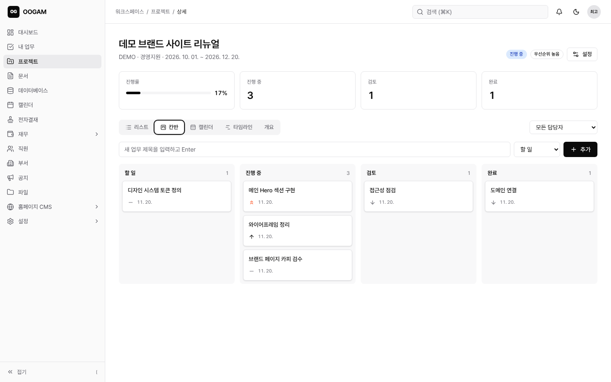

추가 화면: [task-panel-desktop](design-review/screens/admin-task-panel-desktop.png) · [kanban-mobile](design-review/screens/admin-kanban-mobile.png)

**구현 완료**
- 마우스 드래그로 상태 이동, 새로고침 후 유지 확인
- 업무 상세 패널: 담당자·일정·체크리스트·하위 업무·선행 업무·관련 문서·첨부·댓글·변경 이력

**미완성 · 개선 필요**
- 키보드로 카드 이동 불가 (상세 패널에서 상태 변경으로 대체)
- 열마다 "업무 추가" 버튼 없음 (상단 입력란만)
- 날짜 입력이 브라우저 기본 형식으로 표시 (OS 언어에 따라 mm/dd/yyyy)

#### 문서 에디터 — 부분 구현

경로: `/admin/docs · /admin/docs/[id]`

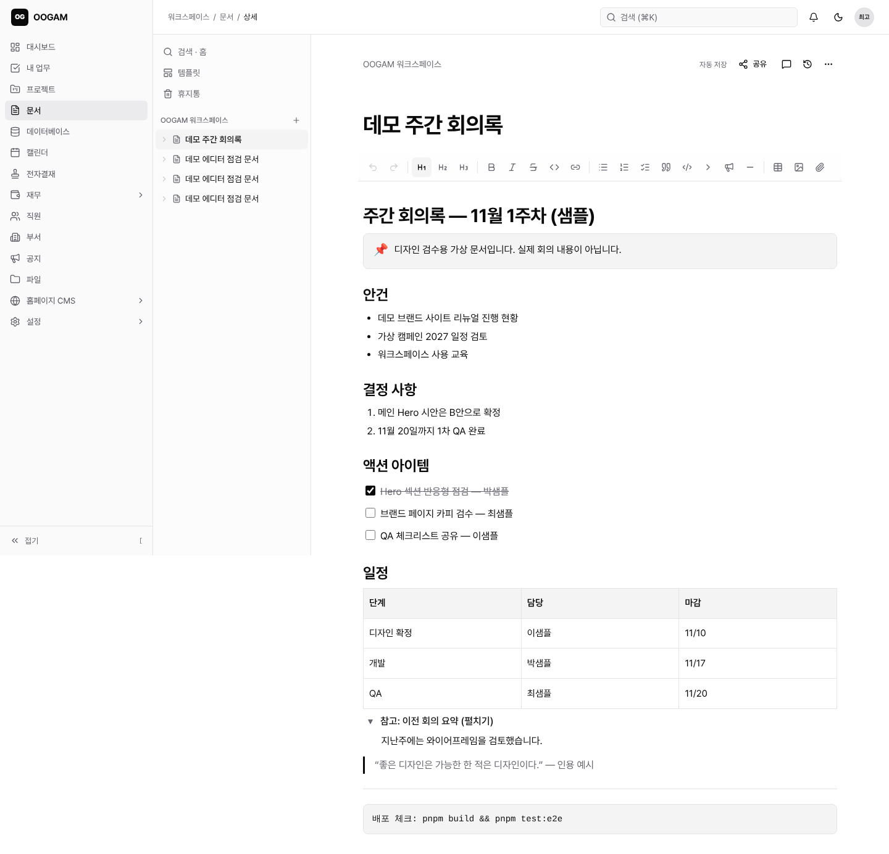

추가 화면: [doc-editor-mobile](design-review/screens/admin-doc-editor-mobile.png) · [docs-home-desktop](design-review/screens/admin-docs-home-desktop.png)

**구현 완료**
- 블록: 제목 1~3, 목록, 체크리스트, 인용, 구분선, 코드, 표, 이미지, 파일, 링크, 토글, 콜아웃, "/" 메뉴
- 자동 저장과 충돌 감지, 버전 기록·복원, 휴지통, 템플릿, 공유 권한, 댓글
- 실시간 공동 편집(협업 서버 가동 시)

**미완성 · 개선 필요**
- 본문 안의 @멘션 미구현 (댓글 멘션은 가능)
- 문서 트리 드래그 정렬 대신 메뉴로 이동
- 툴바가 아이콘만 있어 처음 쓰는 사람이 기능을 알기 어려움, 모바일에서 3줄로 늘어남

#### 데이터베이스 — 부분 구현

경로: `/admin/databases/[id]`

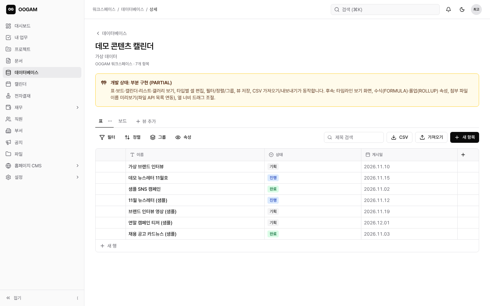

추가 화면: [database-board-desktop](design-review/screens/admin-database-board-desktop.png)

**구현 완료**
- 11개 속성 타입, 셀 값 검증
- 표·보드·캘린더·리스트·갤러리 보기, 필터·정렬·그룹, 저장된 보기, CSV 가져오기·내보내기

**미완성 · 개선 필요**
- 타임라인 보기, 수식(Formula)·롤업 속성 미구현 (화면에 노란 개발 상태 안내)
- 파일 셀에 파일 이름 대신 개수만 표시
- 1440px에서도 보드 4번째 열이 잘림 (가로 스크롤)

#### 캘린더 — 부분 구현

경로: `/admin/calendar`

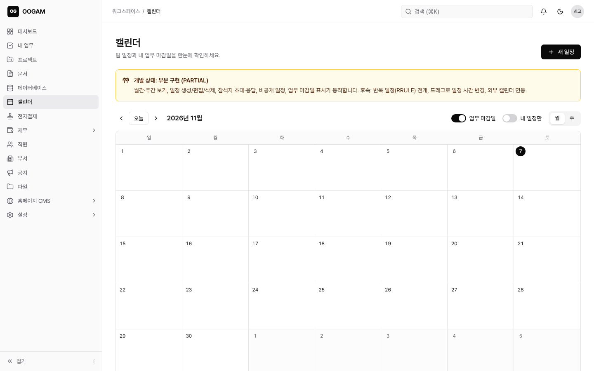

**구현 완료**
- 월·주 보기, 일정 생성·수정, 참석자·응답, 비공개 일정, 업무 마감일 함께 보기

**미완성 · 개선 필요**
- 반복 일정은 저장만 되고 달력에 펼쳐지지 않음
- 외부 캘린더(Google 등) 연동 없음

#### 재무 — 구현 완료

경로: `/admin/finance · /budgets · /transactions`

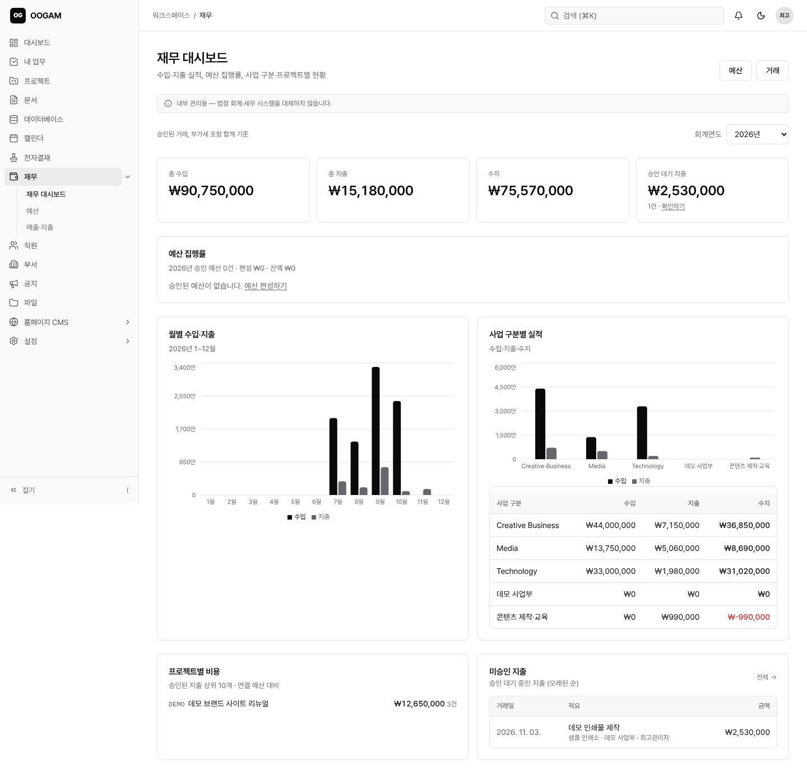

추가 화면: [finance-mobile](design-review/screens/admin-finance-mobile.png) · [budgets-desktop](design-review/screens/admin-budgets-desktop.png) · [transactions-desktop](design-review/screens/admin-transactions-desktop.png)

**구현 완료**
- 재무 대시보드: 총수입·지출·수지, 승인 대기, 월별 추이, 사업 구분별 실적, 프로젝트별 비용
- 예산 편성·승인과 실제 집행 분리, 거래 등록(부가세 자동), 증빙, 승인·반려, CSV
- 권한 없는 직원은 메뉴·화면·API 모두 차단

**미완성 · 개선 필요**
- "내부 관리용 — 법정 회계·세무 시스템을 대체하지 않습니다" 고지 유지 필요
- 엑셀(XLSX) 리포트 내보내기 없음

#### 전자결재 — 구현 완료

경로: `/admin/approvals`

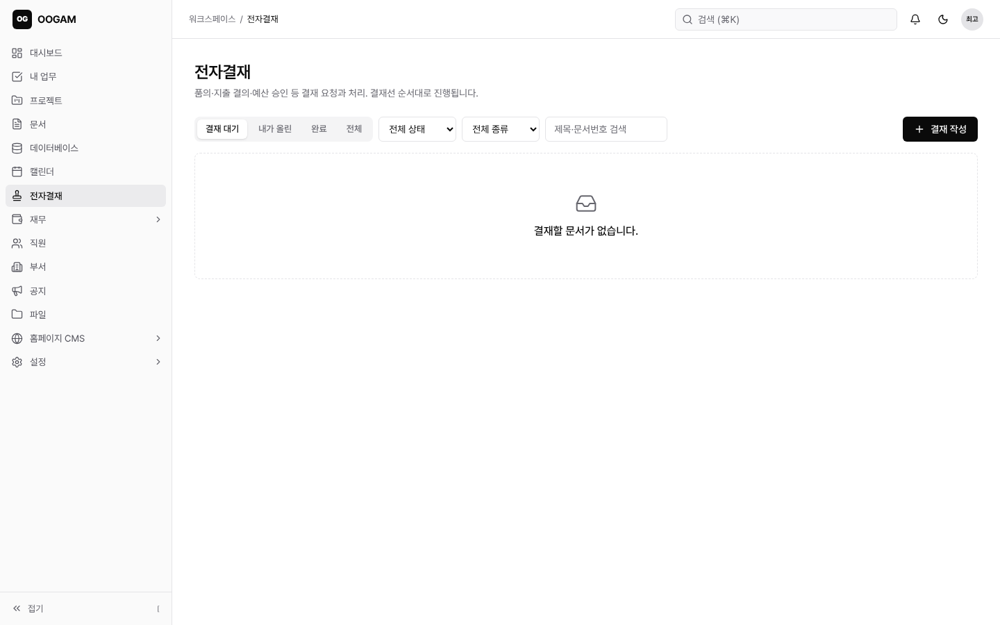

추가 화면: [approval-detail-desktop](design-review/screens/admin-approval-detail-desktop.png) · [approvals-mobile](design-review/screens/admin-approvals-mobile.png)

**구현 완료**
- 결재 작성(유형·금액·결재선·첨부), 승인·반려·보완 요청·재상신·취소, 처리 이력
- 동시 승인 충돌 방지, 결재 요청·완료 알림, 프로젝트·예산·거래 연결

**미완성 · 개선 필요**
- 결재 양식 템플릿·전결 규정 없음
- 상세를 열었을 때 왼쪽 목록 탭과 문서가 일치하지 않는 경우가 있음 (예: "결재 대기" 탭에 없는 문서)

#### 직원 관리 — 구현 완료

경로: `/admin/employees · /admin/teams`

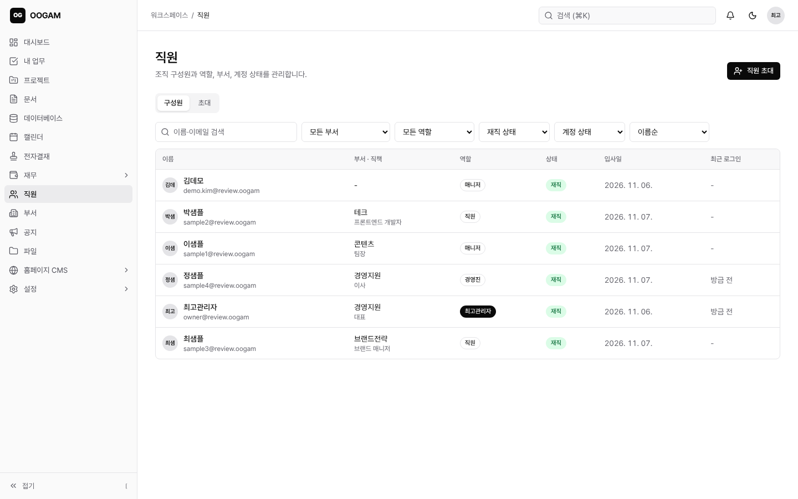

추가 화면: [employee-detail-desktop](design-review/screens/admin-employee-detail-desktop.png) · [employees-mobile](design-review/screens/admin-employees-mobile.png) · [teams-desktop](design-review/screens/admin-teams-desktop.png)

**구현 완료**
- 직원 목록·검색·필터, 초대 링크 발급, 역할·부서·직책 변경, 계정 비활성화
- 민감 인사정보(급여)는 별도 권한자만 열람
- 부서 트리·부서장·구성원

**미완성 · 개선 필요**
- 조직도 시각화 없음
- 직원 상세 패널은 배경을 흐리게, 업무 패널은 어둡게 처리해 두 패널의 동작이 다름

#### 홈페이지 CMS · 설정 — 구현 완료

경로: `/admin/cms/pages · /admin/settings`

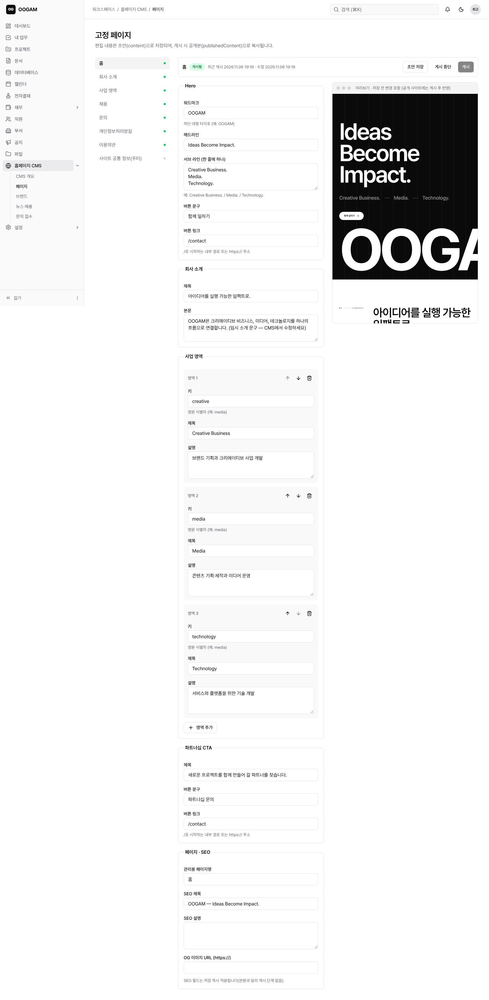

추가 화면: [settings-desktop](design-review/screens/admin-settings-desktop.png)

**구현 완료**
- 페이지별 구조화 편집 + 실시간 미리보기, 초안/게시 분리, 게시 권한 분리
- 내 계정: 비밀번호 변경, 로그인 기기 관리, 2단계 인증

**미완성 · 개선 필요**
- 페이지 SEO 항목은 초안 없이 저장 즉시 반영

## 4. 업무 흐름 요약

1. **방문자**: 메인 → 회사 소개·사업 영역·브랜드·포트폴리오 → 문의 작성 → (관리자) 문의 접수 알림
2. **직원**: 로그인(2단계 인증) → 대시보드 → 내 업무 → 프로젝트 칸반에서 상태 이동 → 업무 상세에서 댓글·첨부 → 회의록 문서 작성(자동 저장)
3. **경영**: 지출 거래 등록 → 전자결재 상신 → 결재선 승인 → 재무 대시보드 반영
4. **홈페이지 운영**: CMS에서 초안 작성 → 미리보기 → 게시 권한자가 게시 → 공개 사이트 즉시 반영

## 5. 참고

- 기능·보안 검증 결과: `IMPLEMENTATION_STATUS.md`, `SECURITY.md`
- 이 자료는 소스 코드를 변경하지 않고 작성했습니다. 캡처용 가상 데이터는 로컬 검수 DB(`oogam_review`)에만 있으며 운영 환경과 무관합니다.
